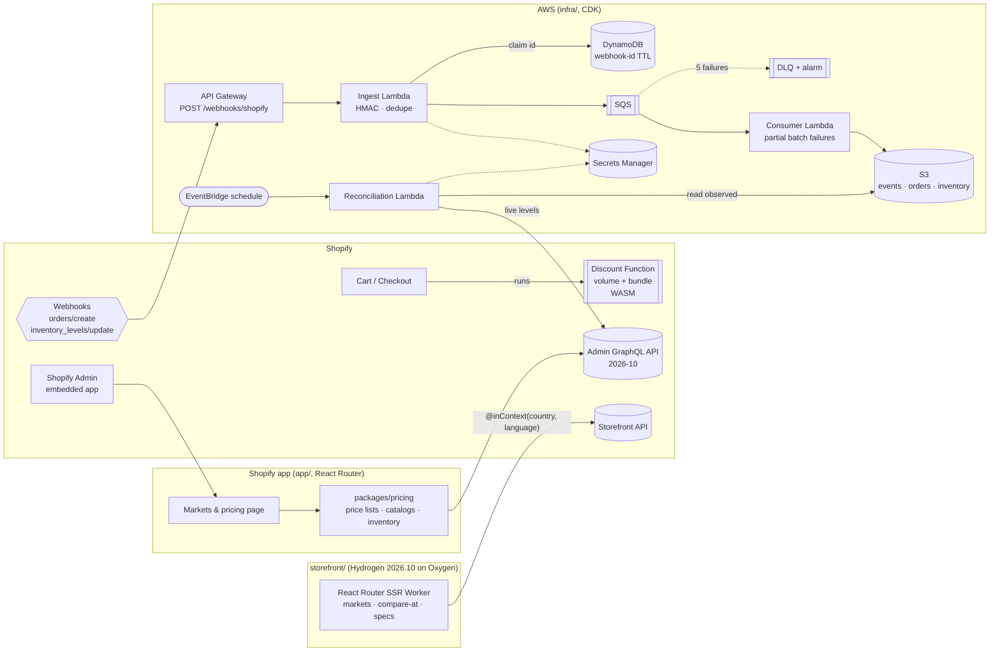

# shopify-commerce-lab

A Shopify app, a Discount Function, a Markets/Catalogs pricing module, a Hydrogen storefront and an AWS webhook pipeline, built to work through the parts of a Shopify e-commerce platform that are easy to hand-wave: **discount logic that runs inside checkout, multi-market pricing, headless storefronts, and getting order/inventory events out of Shopify reliably.** Built with Claude Code as a learning/portfolio project. It is not a production system and has no users or merchants.

Everything builds and tests locally with **no Shopify, AWS or GitHub account**. The parts that need a real dev store or an AWS deploy are written out as manual steps below.

| Concern | What's here | Where |
|---|---|---|
| Shopify app | Embedded admin app from Shopify's React Router app template (the layout `shopify app init` produces; the Remix template is superseded). Scopes, webhooks and Events declared in `shopify.app.toml`. A *Markets & pricing* page reads markets and price lists through the pricing package | `app/`, `shopify.app.toml` |
| Shopify Functions | Discount Function on the Discount Function API (`cart.lines.discounts.generate.run`, TypeScript). **Tiered volume pricing** → `productDiscountsAdd`; **complete keyboard + mouse + headset bundle** → fixed-amount `orderDiscountsAdd`, capped per cart. Configured by a JSON metafield on the discount, whose `bundleTags` feed the input query as GraphQL variables | `extensions/volume-bundle-discount/` |
| Markets + Catalogs pricing | Typed Admin GraphQL (2026-10) for markets → catalogs → price lists, `priceListCreate` + `catalogCreate`, **idempotent fixed-price sync** via `priceListFixedPricesUpdate` (diff, batch, raise `userErrors`), contextual-price read-back, inventory across locations, `inventorySetQuantities` with compare-and-swap + `@idempotent`. Exact BigInt money math, ISO 4217 minor units, `.99`/increment rounding, compare-at rules | `packages/pricing/` |
| Webhooks → AWS | `orders/create` + `inventory_levels/update` → API Gateway → ingest Lambda (**HMAC-SHA256 on the raw body**, timing-safe, secret rotation; **dedupe on `X-Shopify-Webhook-Id`** with a DynamoDB conditional put + TTL) → **SQS** (+DLQ) → consumer Lambda → **S3** (create-only and `If-Match` conditional writes; out-of-order safe). **EventBridge** schedule → reconciliation Lambda that diffs S3 against live Admin API inventory | `packages/webhooks/`, `infra/` |
| Infra as code | AWS CDK (TypeScript): HTTP API, 3 Node 24 ARM Lambdas (esbuild ESM bundles), DynamoDB, SQS + DLQ + alarm, private/encrypted/versioned S3, EventBridge rule, Secrets Manager. Tested by synthesizing in-process | `infra/` |
| Hydrogen storefront | **Hydrogen 2026.10** (the framework-agnostic toolkit release) inside React Router 7, running as an **Oxygen** Worker (MiniOxygen locally). Storefront API against the public **mock.shop** keyboard catalog: price vs compare-at, market routing with `@inContext`, **metafield-driven spec table** | `storefront/` |
| CI | GitHub Actions: typecheck (+ `hydrogen gql check`), lint, unit tests, admin app build, `cdk synth`, Function WASM fixture tests, Playwright smoke test against the production Worker build | `.github/workflows/ci.yml` |

## Architecture



## Try it

Node 22.12+ or 24.

```bash
npm ci                  # postinstall: prisma generate, Function typegen, Admin API codegen
npm run typecheck       # all workspaces, plus `hydrogen gql check` on storefront queries
npm run lint
npm run test:unit       # Function logic, pricing, webhooks, CDK assertions, storefront libs
npm run test:function   # builds the Function to WASM, runs fixtures in function-runner
npm run test:e2e        # Playwright vs. the storefront production build in MiniOxygen
```

Run the storefront (no account, reads `mechanical-keyboards.mock.shop`):

```bash
cp storefront/.env.example storefront/.env
npm run dev --workspace storefront          # http://localhost:5173
```

Then open `/products/wireless-ergonomic-mouse` (on sale: $49.99 vs $64.99) and switch markets in the header (`/en-ca/...`, `/ja-jp/...`).

Preview a Function run against one fixture without a store:

```bash
cd extensions/volume-bundle-discount
jq .payload.input tests/fixtures/bundle-complete-plus-tier.json > /tmp/input.json
npx shopify app function run --input /tmp/input.json --export cart-lines-discounts-generate-run --json
```

It prints the operations plus the WASM instruction count and memory use.

Synthesize the AWS stack (bundles the Lambdas, no credentials needed):

```bash
npm run synth --workspace @commerce-lab/infra -- --quiet
```

## What each piece demonstrates

### Discount Function (`extensions/volume-bundle-discount`)

- **Input query** (`src/cart_lines_discounts_generate_run.graphql`) asks only for what the logic needs: line quantity, gift-card flag, `hasTags(tags: $bundleTags)`, the discount's `discountClasses` and its configuration metafield. `$bundleTags` comes from the metafield JSON via `[extensions.input.variables]`, so the merchant changes bundle slots without a deploy.
- **Run function** (`src/cart_lines_discounts_generate_run.ts`): total eligible units pick one volume tier, applied to every eligible line as one `productDiscountsAdd` candidate; complete bundles = the scarcest slot's unit count, capped by `maxBundles`, as a fixed `orderDiscountsAdd` on the subtotal. Respects `discountClasses` (a discount created with only `ORDER` never emits product discounts). Gift cards are excluded. Money is computed in integer cents.
- **Config** example (stored on the discount as `$app:volume-bundle.function-configuration`):

  ```json
  {
    "volumeTiers": [{ "minQuantity": 3, "percentage": 5 }, { "minQuantity": 5, "percentage": 10 }, { "minQuantity": 10, "percentage": 15 }],
    "bundleTags": ["bundle:keyboard", "bundle:mouse", "bundle:headset"],
    "bundle": { "amountOff": "20.00", "maxBundles": 2, "message": "Battlestation bundle" }
  }
  ```

- **Tests**: `tests/unit` covers config parsing and edge cases in Node. `tests/function.test.js` uses `@shopify/shopify-function-test-helpers` to build the real WASM with the Shopify CLI (Javy) and execute each `tests/fixtures/*.json` in Shopify's `function-runner` (the same path as `shopify app function run`), validating the input query, the fixture input and the expected output against the Function API schema.

API version: `2026-07`, matching the `schema.graphql` that ships with Shopify's discount template. Bump with `shopify app function schema` once the app is linked.

### Markets / Catalogs pricing (`packages/pricing`)

- `schema/admin-2026-10.graphql` is the public Admin API introspection (re-fetch with `npm run schema:fetch -w @commerce-lab/pricing`). Every document in `src/graphql/operations.ts` is validated against it in tests and typed with graphql-codegen.
- `planMarketPrice`: shop price → market currency at a given rate, optional market uplift, rounding (`ending: 0.99`, `increment: 100` for JPY, `0.05` for CHF), per-variant overrides. Compare-at prices are converted the same way and **dropped when rounding would make them not strictly higher** than the price (no fake "sale").
- `syncFixedPrices`: reads current FIXED prices (paginated), diffs, and sends only changes through `priceListFixedPricesUpdate` in batches; re-running is a no-op. `userErrors` (e.g. `PRICE_LIST_CURRENCY_MISMATCH`) and top-level errors (e.g. throttling) are raised, not swallowed.
- `createMarketPriceList`: `priceListCreate` (with percentage parent adjustment) then `catalogCreate` scoped to a market.
- Inventory: `getInventorySnapshot` aggregates `available/on_hand/committed/incoming` across all locations; `findDrift` compares with webhook-derived state; `setAvailableWithCas` uses `changeFromQuantity` and an `@idempotent` key, both required for `inventorySetQuantities` since 2026-04.
- Fixed prices are stored exactly as sent. Shopify's Markets rounding applies to prices *it* converts, so an app writing fixed prices owns rounding. That's why rounding lives here.

### Webhooks → SQS → S3 (`packages/webhooks`, `infra`)

- **HMAC**: computed over the raw bytes (API Gateway base64 bodies are decoded first; re-serialized JSON would not match), compared with `timingSafeEqual`, several secrets accepted during rotation.
- **Idempotency**: `shop#X-Shopify-Webhook-Id` claimed with `attribute_not_exists(pk)`, TTL 24h (Shopify retries a failed delivery up to 8 times over 4 hours). The ingest Lambda has a 5 s timeout to match Shopify's 5-second response limit, which is why business logic runs behind SQS. If SQS fails after the claim, the claim is released and the response is 500, so Shopify's retry is processed instead of dropped as a duplicate. SQS FIFO dedupe was not used because its window is 5 minutes.
- **Ordering**: Shopify doesn't guarantee order. The "latest inventory" object is last-writer-wins on the payload's `updated_at`, written with S3 `If-Match` (or `If-None-Match: *` on create) so racing consumers can't overwrite a newer value.
- **At-least-once SQS**: raw events and orders are written create-only, so redelivery is harmless; the consumer returns `batchItemFailures` so only failed records retry, then go to the DLQ after 5 receives.
- **64-bit IDs**: Shopify ids such as `271878346596884015` exceed `Number.MAX_SAFE_INTEGER`, and `JSON.parse` silently rounds them. Payloads are parsed with a reviver that keeps the source digits (Node 21+ `context.source`). The end-to-end test caught this.
- **Reconciliation**: an EventBridge rule (hourly by default) runs a Lambda that compares S3's latest inventory per item/location with live Admin API levels and writes `reconciliation/.../<run>.json`. It reports drift; it does not auto-correct (`setAvailableWithCas` is there for that, guarded by CAS).
- **Alternative not taken**: Shopify can deliver webhooks straight to an Amazon EventBridge partner event source. HTTPS + HMAC was chosen here because the brief was to implement and test signature verification and dedupe explicitly.

### Hydrogen storefront (`storefront`)

- Hydrogen **2026.10** is a toolkit, not a framework (2026-04 and earlier were Remix/React Router based). This app uses React Router 7 framework mode with Hydrogen's `createStorefrontClient` created per request in root middleware, Oxygen's Workers Cache + `waitUntil` threaded through context, a module Worker `server.ts`, and Web-streams SSR. `vite build` produces one Worker bundle + `oxygen.json`.
- **Markets**: `defineShopifyI18n` with path prefixes (`/en-ca`, `/en-gb`, `/de-de`, `/ja-jp`). Queries declare `$country`/`$language` + `@inContext`; Hydrogen injects them from the URL. Unknown prefixes return 404 so each page has one canonical URL. Prices are rendered with `formatMoney` in the market's locale.
- **Price vs compare-at**: the compare-at price and "Save N%" show only when compare-at is strictly higher in the same currency; the saving is rounded down.
- **Spec table**: `metafields(identifiers: specs.*)` rendered by metafield type (text, integer with unit, boolean, `weight`/`dimension` JSON, lists). A unit test pins the query's identifiers to the table's field list.
- **mock.shop**: `mechanical-keyboards.mock.shop` (ClickyCanvas) is tokenless. Two honest limits: each mock store sells in **one currency**, so `/en-ca` still returns USD (formatted as `US$49.99`); and mock catalogs define **no product metafields**, so the page shows a labelled catalog-field fallback. Against a real store with a CAD market and `specs.*` metafields, the same code shows CAD and the metafield table, and the unit tests cover both paths with mocked responses.

## Connect it to a dev store (manual, needs your accounts)

None of this is required for the tests. Do it yourself; nothing here creates accounts or stores credentials.

1. Create a Shopify Partner account and a development store (Partner Dashboard → Stores → Add store → Development store).
2. `npm run config:link`: pick/create the app; this fills `client_id` in `shopify.app.toml`.
3. `npm run dev`: the CLI tunnels the app, installs it on the dev store and pushes `shopify.app.toml` (scopes, webhooks, the Function extension).
4. Create the automatic discount backed by the Function (Admin GraphQL, from the app's GraphiQL in `shopify app dev`):

   ```graphql
   mutation {
     discountAutomaticAppCreate(automaticAppDiscount: {
       title: "Volume + bundle"
       functionHandle: "volume-bundle-discount"
       discountClasses: [PRODUCT, ORDER]
       startsAt: "2026-01-01T00:00:00Z"
       combinesWith: { orderDiscounts: false, productDiscounts: false, shippingDiscounts: true }
       metafields: [{ namespace: "$app:volume-bundle", key: "function-configuration", type: "json",
         value: "{\"volumeTiers\":[{\"minQuantity\":3,\"percentage\":5}],\"bundleTags\":[\"bundle:keyboard\",\"bundle:mouse\",\"bundle:headset\"],\"bundle\":{\"amountOff\":\"20.00\",\"maxBundles\":2,\"message\":\"Battlestation bundle\"}}" }]
     }) { automaticAppDiscount { discountId } userErrors { field message } }
   }
   ```

   Tag three products `bundle:keyboard`, `bundle:mouse`, `bundle:headset` and add them to a cart.
5. Markets: in Settings → Markets add e.g. Canada with CAD, then use `createMarketPriceList` / `syncFixedPrices` (or the admin page at `/app/markets` to see what exists).
6. `orders/create` requires *protected customer data* access: declare it in the Partner Dashboard (App setup → Protected customer data) before subscribing.

## Deploy the AWS pipeline (manual)

1. Configure AWS credentials yourself (`aws configure sso` or similar), then `npx cdk bootstrap` once per account/region from `infra/`.
2. `npm run deploy --workspace @commerce-lab/infra -- -c shopDomain=<your-store>.myshopify.com`
3. Put the secret value (the app's client secret signs webhooks; a custom-app or offline Admin token for reconciliation):

   ```bash
   aws secretsmanager put-secret-value --secret-id <ShopifySecretArn output> \
     --secret-string '{"webhookSecrets":["<app client secret>"],"adminAccessToken":"<shpat_...>"}'
   ```

4. Paste the `WebhookUrl` output into the commented `orders/create` / `inventory_levels/update` subscription in `shopify.app.toml`, uncomment it, and run `npm run deploy` (Shopify CLI) to push the config.
5. Place a test order; objects appear under `orders/` and `events/` in the bucket. `npm run destroy` isn't scripted on purpose: the bucket is `RETAIN`.

## Deploy the storefront to Oxygen (manual)

Needs a Shopify store with the Hydrogen sales channel. In `storefront/`: `npx shopify hydrogen link` → `npx shopify hydrogen env pull` (fills `PUBLIC_STORE_DOMAIN` / `PUBLIC_STOREFRONT_API_TOKEN`) → `npm run build && npm run deploy`. Not done in this repo.

## How it's tested

| Layer | Test | Needs network? |
|---|---|---|
| Discount Function logic | Vitest unit tests on the TypeScript | no |
| Discount Function as shipped | WASM built by Shopify CLI, 8 fixtures run in `function-runner` with schema validation of query, input and output | first run downloads Javy/function-runner |
| Pricing GraphQL | every document validated against the pinned Admin 2026-10 schema | no |
| Pricing orchestration | mocked Admin client: pagination, batching, no-op re-sync, `userErrors`, throttling, CAS variables | no |
| Webhook handlers | HMAC (tamper, wrong secret, rotation), dedupe, release-on-SQS-failure, ignored topics, out-of-order inventory, write conflicts, partial batch failures, 64-bit ids | no |
| AWS adapters | `aws-sdk-client-mock` for DynamoDB conditional put, S3 conditional writes/412, pagination, Secrets Manager caching | no |
| Whole pipeline | signed request → ingest → queue → consumer → S3 → reconciliation with a mocked Admin API, in memory | no |
| Infra | `aws-cdk-lib/assertions` on the synthesized template (routes, DLQ, visibility timeout, TTL, TLS-only bucket, schedule, least-privilege IAM) and a real `cdk synth` with bundling in CI | no |
| Storefront libs | locale resolution, localized hrefs, `@inContext` variables via mocked `fetch`, spec table, savings | no |
| Storefront end to end | Playwright vs. the production Worker in MiniOxygen: catalog renders, $49.99 vs $64.99 / Save 23%, spec table, market switch to `/en-ca`, 404s | yes (mock.shop) |

## Limits, stated plainly

- Never deployed to a real store or AWS account from this repo; the "connect" and "deploy" sections are the steps to do that, not a record of having done it.
- mock.shop stores are single-currency with no product metafields, so the live demo shows the market *request* and the fallback spec table; multi-currency output and metafield rendering are covered by unit tests with mocked Storefront API responses.
- The storefront is a product listing and product page only: no cart, checkout, customer accounts, search or analytics.
- The admin app is the template plus one read-only page; price-list writes are library functions, not admin UI.
- Exchange rates for fixed prices are inputs to `planMarketPrice`; nothing fetches live FX rates.
- Reconciliation reports drift and caps Admin API calls per run; it doesn't page through every inventory item in a large catalog or auto-correct.
- Function `api_version` is 2026-07 (the template's bundled schema), one quarter behind the Admin API's 2026-10.

## License

MIT
